# Ultima previsione WRF — ciclo ECMWF 20261017 00Z

> Esperimento personale, **non un servizio ufficiale**: può sbagliare e non sostituisce bollettini e allerte della Protezione Civile e dell'Aeronautica Militare. Nessuna garanzia.
>
> Dati di partenza: ECMWF IFS open data (CC BY 4.0, dati modificati). Modello: WRF (NCAR). Temperatura del mare: MUR SST (NASA JPL), quando disponibile. Stazioni: Weather Underground, usate solo dentro il modello e non ripubblicate. Fonti e licenze: [README del progetto](https://github.com/Superbug87/wrf-lazio#fonti-dei-dati-e-licenze).
>
> Le immagini «radar_*» contengono dati Radar-DPC, Dipartimento della Protezione Civile (radar.protezionecivile.it), licenza [CC BY-SA 4.0](https://creativecommons.org/licenses/by-sa/4.0/): le immagini ricavate da quei dati hanno la stessa licenza.

Una immagine per ogni ora e variabile: cartella [orarie/](orarie/), elenco in [indice.json](orarie/indice.json).

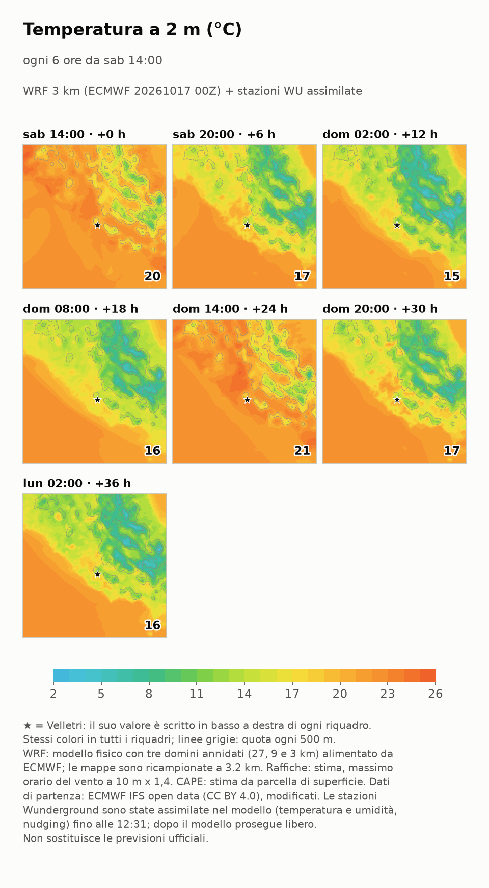

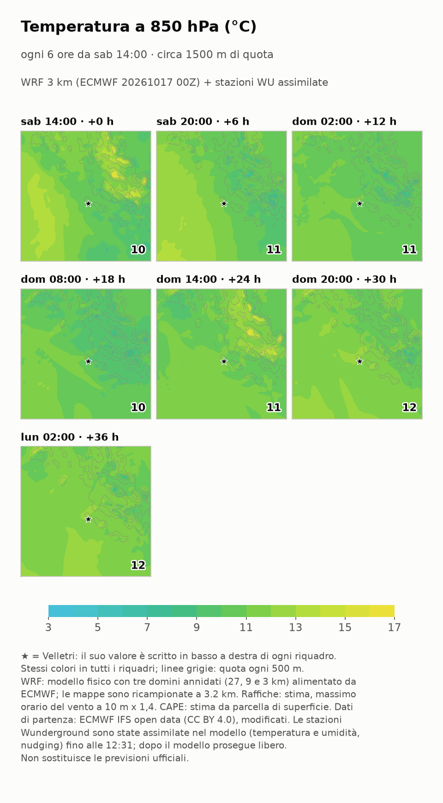

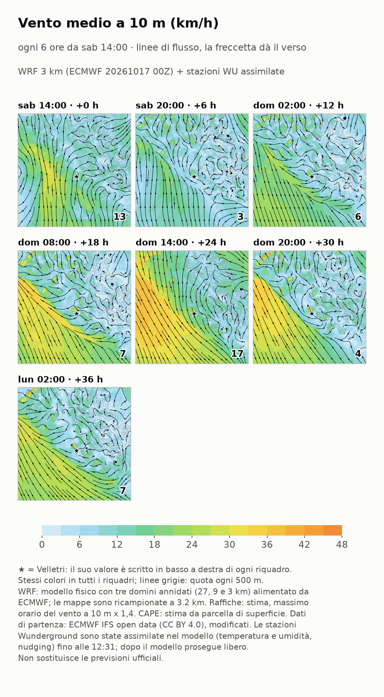

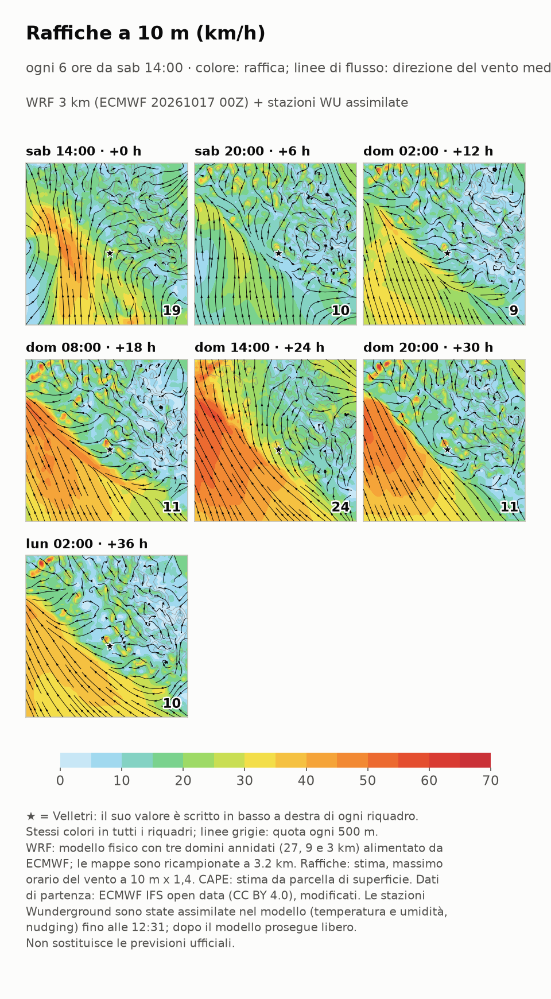

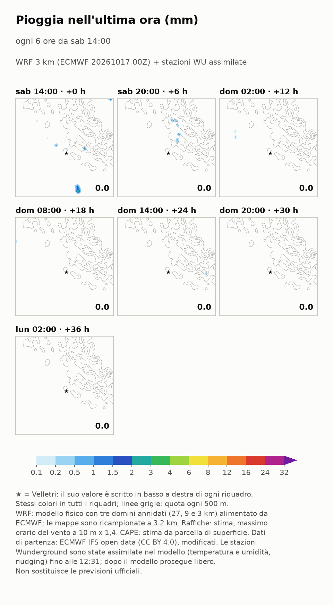

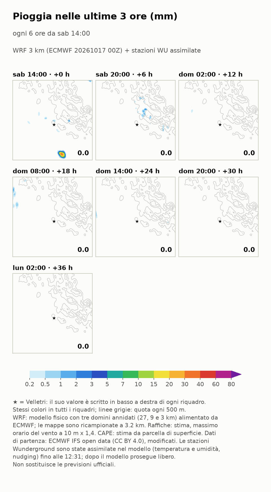

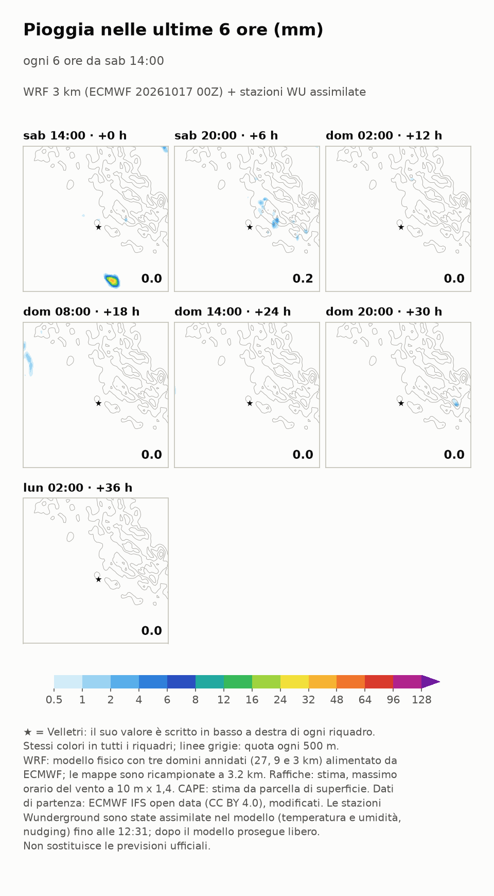

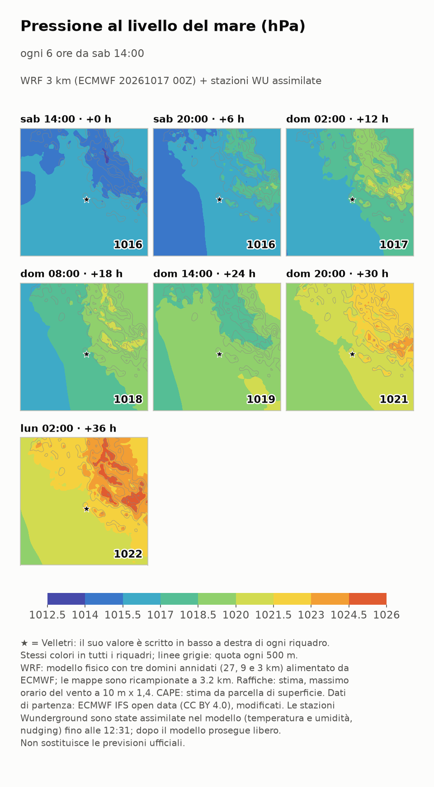

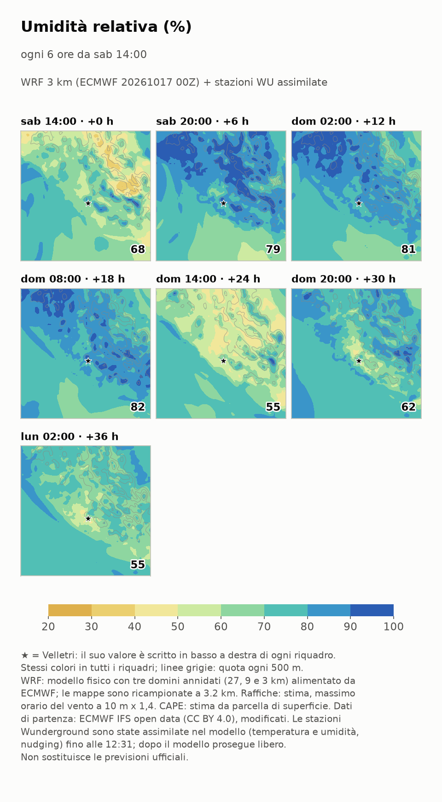

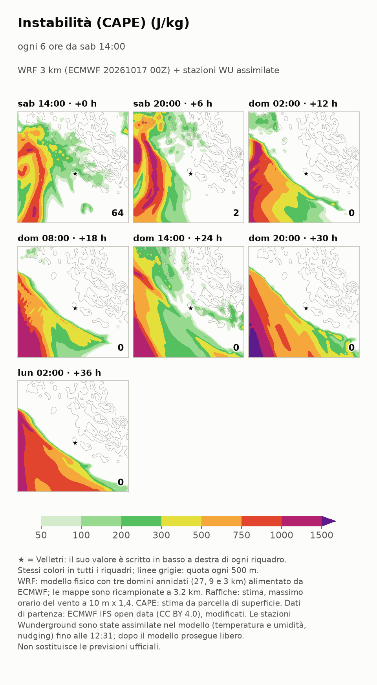

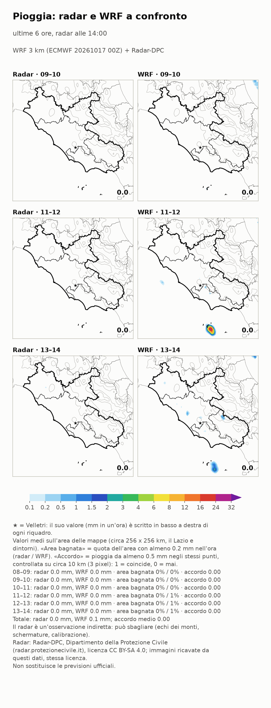

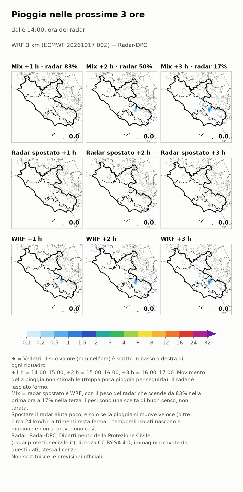

